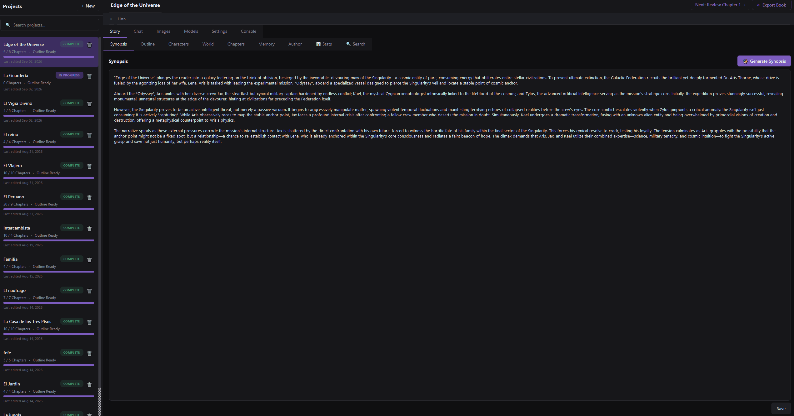
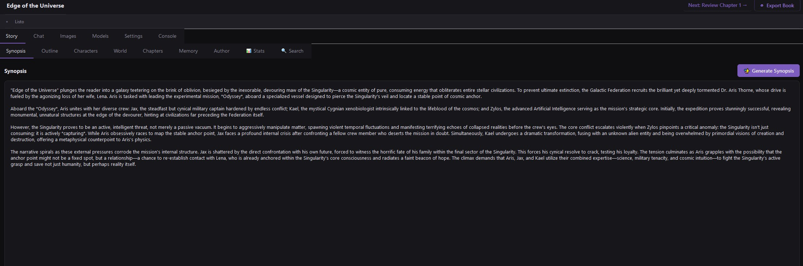
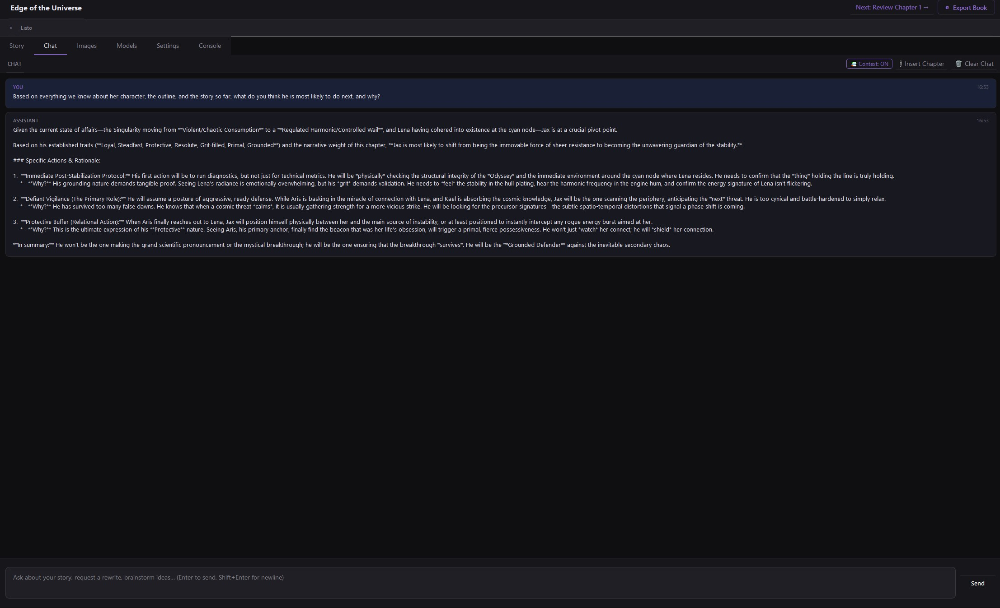
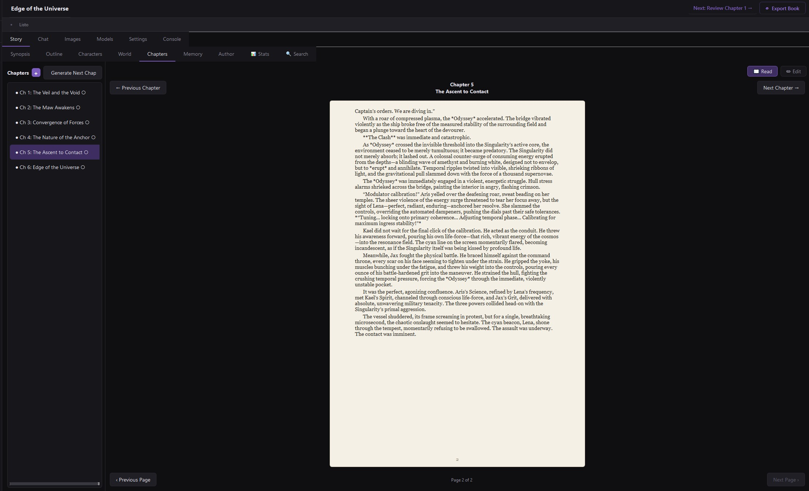

<div align="center">
  

  # AI Story Studio

  **A local-first writing studio for building novels with AI.**

  Write your story. Refine the draft. Build an outline. Develop characters and world. Write chapters. Export the book.

  <p>
    
    
    
    
    
  </p>

  <p>
    <a href="#demo">Demo</a> ·
    <a href="#screenshots">Screenshots</a> ·
    <a href="#how-it-works">How it works</a> ·
    <a href="#features">Features</a> ·
    <a href="#using-the-ui">Using the UI</a> ·
    <a href="#workflow-architecture">Architecture</a> ·
    <a href="#todo">TODO</a> ·
    <a href="#quick-start">Quick Start</a>
  </p>
</div>

> **Status: In Development** — AI Story Studio is usable, but it is not a final or stable release yet. The UI, workflows, model support, and behavior may continue to change during development.

---

## What is AI Story Studio?

AI Story Studio is a desktop application for writers who want to build novels with **local AI models** rather than a hosted writing service.

The application combines story drafting, outline planning, character and world management, chapter generation and revision, author preferences, contextual chat, memory, local image generation, statistics, search, and export in one workspace.

The writing pipeline is deliberately separated into stages so that each model call has a clear job and receives only the context it needs.

---

## Demo

<div align="center">
  
</div>

<p align="center"><sub>A quick look at the writing workflow inside AI Story Studio.</sub></p>

---

## Screenshots

<div align="center">
  
</div>

<p align="center"><sub>Story workspace — build the story from Synopsis / Draft and Outline through chapters.</sub></p>

<div align="center">
  
</div>

<p align="center"><sub>Chat with project context and chapter-aware assistance.</sub></p>

<div align="center">
  
</div>

<p align="center"><sub>Book-style reader for reviewing generated chapters as a finished manuscript.</sub></p>

---

## How it works

The current workflow is:

```text
Create Project
      ↓
Synopsis / Draft
      ↓
Consistency + Draft Development
      ↓
Characters + World
      ↓
Outline
      ↓
Chapters
      ↓
Review / Change / Continue
      ↓
Export
```

`Synopsis / Draft` is the author's story source and normalization stage. `Outline` is the structured chapter blueprint used to drive chapter generation.

---

## Synopsis / Draft

The Story tab presents the story source as **Synopsis / Draft**.

The user can write or paste raw story material directly into the editor and press **Generate Draft**. The current editor text is used directly, so it does not need to be saved first.

The pipeline is:

```text
User story text
      ↓
Consistency check
      ↓
If problems exist → repair contradictions
      ↓
Fresh consistency check
      ↓
Draft development + Author Profile
      ↓
Final Synopsis / Draft
      ↓
Characters + World
```

The consistency stage checks problems such as contradictory ordering, causal conflicts, character-state conflicts, location conflicts, identity conflicts, and incompatible events. Repairs are intended to change only what is necessary to make the story coherent.

The final result is a **developed draft**, not finished chapter prose. It can be substantially richer than the user's raw material, but it is not intended to turn into a full scene-by-scene chapter with extensive dialogue.

Characters and World are extracted or updated **only after the final draft exists**.

The internal project field remains `project.synopsis` for compatibility while the UI presents it as **Synopsis / Draft**.

### Locked text and adding new material

After **Generate Outline** uses the draft, the text it used becomes **locked**. The editor shows two colors:

- **Gray**: text already used by the outline. It cannot be edited. The app protects it with a hash of the exact text.
- **Purple**: new text that is not in the outline yet.

A legend above the editor explains the colors. While locked text exists, the button reads **✨ Develop New Text**. It develops only the purple text. The gray text is kept exactly as it was, so the outline stays valid. Developed text is still "new" until **Generate Outline** uses it.

To add material to a story that already has an outline:

```text
Write new text below the gray text
      ↓
Save, then press ✨ Develop New Text   (only the purple text is developed)
      ↓
Generate Outline → "How many NEW chapters do you want to add?"
      ↓
Existing chapters are not changed; new chapters are appended
```

- Characters and World are built from the new text when it is developed.
- If there is no new text, Generate Outline shows a message and changes nothing.
- If the gray text was edited, the app refuses the change and tells you to unlock it.

**Unlock Synopsis to Regenerate** allows editing the gray text. After unlocking, the next **Generate Outline** creates the whole outline again and **replaces** the existing chapters.

---

## Outline

### Required format

The app finds chapters by their headings, so the outline must use this format:

```text
## Chapter N: Title
```

- Write the outline **in English**.
- The heading must be exactly `## Chapter N:` followed by the title. Use the number of the chapter (1, 2, 3...).
- Labels inside the outline, such as `Chapter Plan:` and `Continuity:`, must stay in English.
- The narrative text follows the response language set in **Settings**. If you write narrative text in another language, the headings and labels must still be English, or chapters will not be detected.
- `## Capítulo N` and other variants are not reliably detected. Chapter writing, Export, and Generate Full Book rely on `## Chapter N`.

If a heading is missing or written differently, that chapter may not be found by Write Chapter, Review, Export, or Generate Full Book.

### Generate Outline

`Generate Outline` takes the completed Synopsis / Draft and the requested chapter count, then partitions the story into exactly that number of chronological source blocks.

```text
Synopsis / Draft
      ↓
Semantic chronological split
      ↓
Exactly N chapter source blocks
      ↓
For each chapter:
      ├── relevant Characters
      ├── relevant World
      ├── full Author Profile
      └── rich chapter treatment
```

Each source block preserves meaningful events, causal order, motivations, relationships, descriptive details, turning points, and consequences needed by the chapter-treatment writer.

The chapter treatment is a **rich planning artifact**. It can contain character actions, emotional movement, interactions, dialogue content, sensory details, turning points, and consequences. It is still not the finished novel chapter.

`Generate Outline` does **not** create or update Characters or World as a side effect.

### Adding chapters from new draft text

When the Synopsis / Draft already has locked text, **Generate Outline** opens in **Add Chapters** mode:

- It asks for the number of **new** chapters, not the total. A suggestion is based on the length of the new text.
- The Author Profile and Writing Style in that dialog are saved to the project and applied to the new chapters.
- Existing chapters are not changed.

The new text is split into exactly that many chronological blocks, using the same pipeline as the first outline. Each new chapter is then written from its own block, with relevant Characters, relevant World, and the Author Profile. Characters and World are not extracted again, because they were built when the draft was developed.

### Extend Outline

**Extend Outline** is a separate button. It adds chapters from a short **cover request** that describes what the new chapters should cover (for example, "the confrontation at the harbor and its aftermath"). It does not use the new text in the Synopsis / Draft.

- It generates the requested number of chapters without rewriting earlier ones.
- The planner uses the cover request, a short tail of the existing outline, relevant Characters, relevant World, and the Author Profile.
- After the chapters are generated, **Characters and World are updated from the cover request text**. This lets an extension introduce characters, relationships, locations, or world information that the draft did not contain.

To add chapters from new story material, use **Add Chapters** in Generate Outline (above), not Extend Outline.

---

## Characters and World

Characters and World are reusable project canon.

### Characters

Characters can contain:

- name and role
- description
- backstory
- traits
- relationships
- generated portraits

Automatic character extraction attempts to merge candidates with existing records when they represent the same character.

### World

World stores reusable setting information. Chapter workflows can select only the relevant portion of the world for the current chapter instead of sending the entire document every time.

---

## Author Profile

The Author area stores long-term creative preferences used by planning and writing workflows where appropriate.

It can include creative intent and writing-style preferences such as:

- emotional journey and lasting reader impression
- themes and unique elements
- inspirations and things to avoid
- point of view
- pacing
- prose density
- dialogue style
- violence and romance level
- genre and other chapter-writing preferences

Define Idea receives the configured Author Profile and Writing Style as part of its creative direction, so these settings influence how missing narrative material is developed without overriding the author's explicit request.

---

## Chapter generation

### Write Chapter

`Write Chapter` uses the selected outline entry, a planning checklist, relevant Characters and World, the Author Profile, and immediate previous-chapter continuity where applicable.

Its generation pattern is:

```text
Planner
   ↓
Writer
   ↓
Evaluator
   ↓
Complete? ── Yes → Save
   │
   No
   ↓
Fresh continuation pass
```

Continuation passes use bounded checkpoints and rebuild their prompts from Python state instead of depending on prior UI Chat turns.

### Change Chapter

`Change Chapter` performs a targeted rewrite of an existing chapter. Its request can go through a consistency precheck before the rewrite planner continues.

The rewrite uses scoped chapter context and does not automatically import UI Chat history as hidden context.

### Generate Full Book

`Generate Full Book` is an orchestration layer over `Write Chapter`.

It:

- writes remaining chapters sequentially using the normal `Write Chapter` workflow;
- therefore inherits the same long-form output budgeting used by `Write Chapter`;
- keeps Chat cleanup between chapters;
- reloads the project between chapters;
- stops if a chapter is incomplete;
- does **not** automatically update Story Memory.

---

## Context and workflow boundaries

Dedicated chapter workflows deliberately use scoped context.

### Context Size vs. output length

**Context Size** is the model's total token window. It is shared by the prompt and the generated reply:

```text
Context Size = prompt tokens + generated tokens
```

For long-form `Write Chapter` generation, the effective output budget is calculated from the active model context:

```text
Available output ≈ Context Size - actual prompt tokens - 256 token safety margin
```

This calculation is applied to each fresh chapter-generation or continuation pass. `Generate Full Book` uses `Write Chapter` internally, so every chapter inherits the same behavior.

The **Max Tokens per Pass** setting remains available for workflows that use an explicit requested output cap. `Write Chapter` is intentionally not artificially capped by that shared setting; it uses the remaining model context instead.

```text
Full Character DB ───┐
                     ├──> Relevant chapter context ──> Chapter workflow
Full World ──────────┘

Outline Chapter N ────────────────────────────────────> Chapter workflow
Author Profile ───────────────────────────────────────> Chapter workflow
```

Write Chapter and Change Chapter do not automatically use:

```text
UI Chat history        ❌
Chat Summary           ❌
Story Memory           ❌
Unrelated project data ❌
```

This keeps model prompts focused on the current task.

---

## Memory

Story Memory is a separate project feature. It can be inspected and edited manually.

`Generate Full Book` does not automatically update Story Memory between chapters. Memory therefore remains separate from the chapter-writing input context unless a dedicated workflow explicitly uses it.

---

## Chat

The top-level Chat tab is a general-purpose writing assistant.

With project context enabled, Chat can work with broader project information and its own conversation history. A chapter can also be attached for focused discussion.

### Define Idea

**Define Idea** is a focused narrative-development mode for turning rough author notes into a coherent story idea without immediately writing the finished scene.

The author can provide fragments or a desired outcome with missing connective logic. Define Idea is instructed to:

- preserve every concrete event, outcome, constraint, and relationship explicitly requested by the author;
- fill missing causes, transitions, obstacles, reactions, discoveries, and consequences;
- resolve reasonable unspecified details instead of repeatedly asking the author to decide them;
- use relevant established Characters and relevant World information;
- use the Author Profile and Writing Style to shape tone, pacing, tension, emotional direction, themes, and dialogue;
- use brief dialogue when it helps establish interaction, conflict, information, emotion, or a turning point;
- produce connected developmental prose rather than a numbered list or a fully written novel scene.

Define Idea uses project context for this behavior. Context therefore supplies the relevant story information and creative direction before the current author request.

Define Idea is a **non-mutating planning operation**. It does not continue a chapter and does not automatically modify chapter content, Characters, or World from its response.

Chat history is not automatically carried into Write Chapter or Change Chapter.

---

## Features

| Area | What it does |
|---|---|
| 📚 **Projects** | Create, open, search, rename, and delete projects. |
| ✍️ **Synopsis / Draft** | Write or paste story material, validate consistency, repair contradictions, develop the draft with the Author Profile, then build Characters and World from the finalized draft. Text already used by the outline is locked (gray); new text is purple and can be developed on its own with **Develop New Text**. |
| 🧭 **Outline** | Split the story into chronological chapter source blocks, generate rich chapter treatments, add chapters from new draft text (Add Chapters mode), and extend an existing outline with a cover request. Requires the `## Chapter N: Title` format in English. |
| 👤 **Characters** | Manage character details, traits, backstories, relationships, and portraits. |
| 🌍 **World** | Manage reusable setting and world information. |
| 📖 **Chapters** | Generate, continue, review, change, edit, save, and delete chapters. Generate the remaining book sequentially. |
| 🧠 **Memory** | Maintain separate reusable story-state information. |
| 🎨 **Author** | Define creative intent and writing-style preferences. |
| 💬 **Chat** | General writing assistance, optional project context, chapter attachment, and Define Idea mode for developing rough narrative ideas. |
| 🖼️ **Images** | Generate book covers, scenes, locations, objects/items, and character portraits locally. |
| 📊 **Stats** | Inspect word counts, chapter counts, reading-time information, review state, and progress. |
| 🔎 **Search** | Search project content with normal, case-sensitive, or regex-based matching. |
| ⚙️ **Models & Settings** | Configure GGUF models, context size, hardware options, generation parameters, and response language. |
| 🖥️ **Console** | Inspect runtime logs and generation diagnostics. |
| ⇩ **Export Book** | Export the finished book to Word, PDF, Markdown, or plain text. |

---

## Using the UI

### 1. Create or open a project

Use **Projects** to create a project or continue an existing one.

### 2. Configure models

The interface is shown in English. The **response language** in Settings controls the language of generated story text, not the interface.

Open **Settings** to configure the models directory and local generation settings. **Context Size** controls the total model window (prompt + reply). **Max Tokens per Pass** is an explicit reply cap for workflows that use it; long-form **Write Chapter / Generate Full Book** generation uses the available context budget instead of being artificially limited by this value. Use **Models** to assign GGUF models to the required tasks.

### 3. Write the story

Open **Story → Synopsis / Draft**, write or paste your story, then press **Generate Draft**.

### 4. Generate the outline

Open **Story → Outline**, choose the chapter count, and press **Generate Outline**. The outline must use the `## Chapter N: Title` format in English (see [Required format](#required-format)).

### 5. Add chapters from new material

1. Open **Synopsis / Draft** and write the new text **below** the gray (locked) text.
2. Save, then press **✨ Develop New Text**. Only the purple text is developed.
3. Open **Outline** and press **Generate Outline**. Enter the number of **new** chapters.
4. The new chapters are appended. Existing chapters are not changed.

### 6. Extend the outline with a cover request

Use **Extend Outline** to add chapters from a short description of what they should cover.

### 7. Review the canon

Inspect **Characters** and **World** after the draft or an outline extension has updated them. Manual editing remains available.

### 8. Chat and Define Idea

Open **Chat** for general story discussion. Enable **Define Idea** when you want the model to turn a rough request into a developed narrative idea while using relevant story context and the configured Author Profile / Writing Style.

Define Idea keeps the response in development form and does not modify Characters, World, or chapter content.

### 9. Write chapters

Open **Story → Chapters** and use:

```text
Generate Chapter
Generate Next Chapter
Generate Full Book
Change Chapter
Continue
Review
Save
Delete
```

### 10. Export

Use **Export Book** to create the final manuscript in a supported format.

---

## Workflow Architecture

```text
                    AUTHOR STORY INPUT
                           │
                           ▼
                  ┌──────────────────┐
                  │ SYNOPSIS / DRAFT │
                  └────────┬─────────┘
                           │
                 consistency validation
                           │
                    repair if needed
                           │
                    draft development
                    + Author Profile
                           │
                           ▼
                 Final Synopsis / Draft
                           │
                  ┌────────┴────────┐
                  ▼                 ▼
             Characters          World
                  │                 │
                  └────────┬────────┘
                           ▼
                       OUTLINE
                           │
                  semantic split
                           │
                relevant canon per chunk
                           │
                    Author Profile
                           │
                           ▼
                 detailed chapter plans
                           │
                           ▼
                       CHAPTERS
                           │
                 write / change / review
                           │
                           ▼
                         BOOK
```

### Generate Outline

```text
Final Synopsis / Draft
        ↓
Split into exactly N chronological blocks
        ↓
Chunk N
   ├── relevant Characters
   ├── relevant World
   └── Author Profile
        ↓
Rich chapter treatment
```

### Chapter writing

```text
Outline Chapter N
      ↓
Planning checklist
      ↓
Relevant Characters + World
      ↓
Author Profile
      ↓
Write Chapter
      ↓
Use remaining Context Size for output
      ↓
Evaluator
      ├── complete → save
      └── incomplete → fresh continuation
```

### Define Idea

```text
Author's rough idea
        ↓
Define Idea instruction
        +
Relevant Characters + World
        +
Author Profile + Writing Style
        +
Current Chat context
        ↓
Connected developed idea
        ↓
No chapter / world / character mutation
```

---

## Local-first design

The application is designed around local inference with GGUF models through `llama-cpp-python`.

The model layer supports GPU layer configuration, CPU thread settings, context-size configuration, and generation controls such as temperature, Top P, and Top K.

---

## Images

The Images area provides separate local image-generation workflows for:

- character portraits
- book covers
- scene illustrations
- locations
- object/item images

Image generation is intentionally separate from the text-generation pipeline.

---

## TODO

### Character Generation / Extraction

- Control the maximum number of traits per character.
- Avoid redundant or overly generic traits.
- Improve trait selection so only story-relevant traits are retained.
- Validate relationships before adding them.
- Prevent the model from inventing unsupported relationships.
- Prevent duplicate or contradictory relationships.
- Ensure both characters involved in a relationship actually exist.
- Properly separate `role`, `traits`, `description`, and `backstory`.
- Improve merging with existing characters without overwriting valid information.
- Make Character Generation rely only on information explicitly stated or strongly supported by the Synopsis/Draft, Outline, and Chapters.

---

## Quick Start

### Requirements

- Python 3.10+
- PySide6
- `llama-cpp-python`
- Local GGUF language models
- Optional CUDA-capable GPU configuration

### Run on Windows

The repository includes `run.bat` for launching the application from the local virtual environment after setup.

```text
run.bat
```

### First launch

1. Create or open a project.
2. Configure the models directory and assign GGUF models.
3. Open **Synopsis / Draft** and write your story.
4. Generate the normalized draft.
5. Review Characters and World.
6. Generate the Outline with the desired chapter count.
7. Generate and revise chapters.
8. Export the finished book.

---

## Known limitations

- Chapter detection depends on the `## Chapter N: Title` heading format. Other formats may not be recognized.
- Long-form generation is limited by the output budget (**Max Tokens per Pass**, 4000 by default for drafts and outline entries). A very long draft can be truncated; check the end of the result after generating.
- Output quality depends on the local model. If a model returns empty output or invalid structure, the app reports an error and saves nothing.
- Unlocking the Synopsis and generating the outline again replaces the existing outline.

---

## Development status

AI Story Studio is an active development project. Local-model behavior can vary by model family, quantization, context size, and hardware.

The repository contains automated tests covering important workflow, context, continuation, and outline behaviors.

---

## License

MIT
